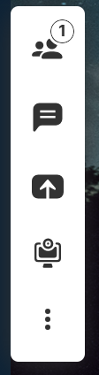
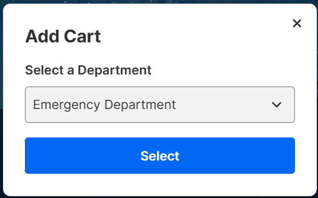
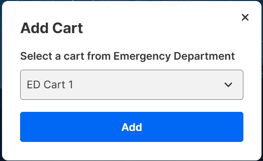
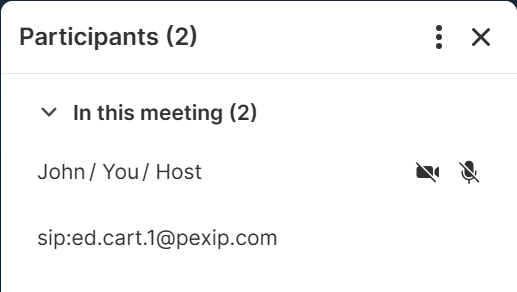

# Web App 3 Plugin: Select Cart

A plugin for Pexip Web App 3 that lets a host pick a department and then a cart
from a predefined configuration. Once a cart is selected, the plugin dials out
to it over SIP (Session Initiation Protocol).

## Table of contents

- [How to use](#how-to-use)
- [Configuration](#configuration)
- [Run for development](#run-for-development)
- [Build for production](#build-for-production)

## How to use

The plugin adds a button to the toolbar for participants with the chair (host)
role.

1. Click the toolbar button to open the selection dialog.

   <div align='center'>

   

   </div>

2. Select a department from the list. If no departments are configured, or the
   configuration file is invalid, a message is shown instead.

   <div align='center'>

   

   </div>

3. Select a cart from the list. If the department has no carts, a message is
   shown instead.

   <div align='center'>

   

   </div>

4. The plugin dials out to the selected cart.

   <div align='center'>

   

   </div>

## Configuration

Both configuration files are located in [public/config](./public/config) and are
loaded by the plugin at runtime.

### Departments (`departments.json`)

This file defines the departments and their carts. Each key is a department
name, shown in the selection dialog:

- **Department name** (the key): A descriptive name, e.g. "Emergency
  Department".
- **id**: A unique identifier for the department, e.g. `"1"`.
- **carts**: An array of cart objects, each with:
  - **label**: A descriptive name shown in the dialog, e.g. "ED Cart 1".
  - **id**: A unique identifier for the cart. It is used as the user part of the
    SIP address that is dialed (`sip:<id>@<host>`).

```json
{
  "Emergency Department": {
    "id": "1",
    "carts": [
      {
        "label": "ED Cart 1",
        "id": "ed.cart.1"
      },
      {
        "label": "ED Cart 2",
        "id": "ed.cart.2"
      },
      {
        "label": "ED Cart 3",
        "id": "ed.cart.3"
      }
    ]
  },
  "Cardiovascular": {
    "id": "2",
    "carts": [
      {
        "label": "CV Cart 1",
        "id": "cv.cart.1"
      },
      {
        "label": "CV Cart 2",
        "id": "cv.cart.2"
      }
    ]
  }
}
```

To add a department or cart, add a new entry to this file. For example, to add a
cart to the "Emergency Department", append an object to its `carts` array:

```json
{
  "label": "ED Cart 4",
  "id": "ed.cart.4"
}
```

### SIP (`sip.json`)

This file defines how the dial out is made:

- **host**: The SIP domain appended to the cart id, e.g. `"pexip.com"`.
- **role**: The role of the dialed participant, either `"HOST"` or `"GUEST"`.

```json
{
  "host": "pexip.com",
  "role": "GUEST"
}
```

With the configuration above, selecting "ED Cart 1" dials
`sip:ed.cart.1@pexip.com`.

## Run for development

Requirements:

| Node.js            | npm           |
| ------------------ | ------------- |
| v20.19.0 or higher | v10 or higher |

1. Install the dependencies:

   ```bash
   npm install
   ```

2. Create a `.env` file in the project root (see
   [.env.example](./.env.example)):

   ```bash
   VITE_INFINITY_TARGET=https://your-pexip-infinity-server.com
   # Optional, defaults to 5173
   VITE_DEV_SERVER_PORT=5173
   ```

   - `VITE_INFINITY_TARGET` (required): the Pexip Infinity server hosting Web
     App 3. The dev server proxies `/webapp3` and `/api` to it.
   - `VITE_DEV_SERVER_PORT` (optional): the port of the local dev server.

3. Start the development server:

   ```bash
   npm start
   ```

The dev server opens Web App 3 at <https://localhost:5173/webapp3/> (accept the
self-signed certificate on first use). It serves a development branding manifest
at `/webapp3/branding/manifest.json` that loads the plugin from the local dev
server, so no branding changes are needed on the Infinity server. For more
information on how to configure your environment, see the
[Developer Portal: Setup guide for plugin developers](https://developer.pexip.com/docs/plugins/webapp-3/setup-guide-for-plugin-developers).

## Build for production

1. Install the dependencies:

   ```bash
   npm install
   ```

2. Build the package:

   ```bash
   npm run build
   ```

The package is created in the `dist` folder, including the `config` files from
`public`. Next, create a Web App 3 branding and copy the contents of `dist` into
it.

To learn more about deploying plugins in Pexip Infinity, see the
[Developer Portal](https://developer.pexip.com).
